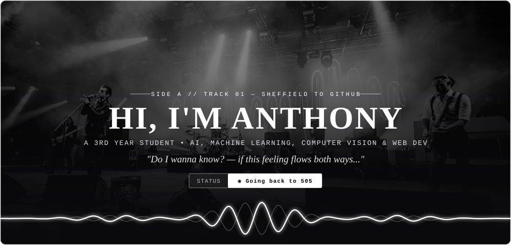
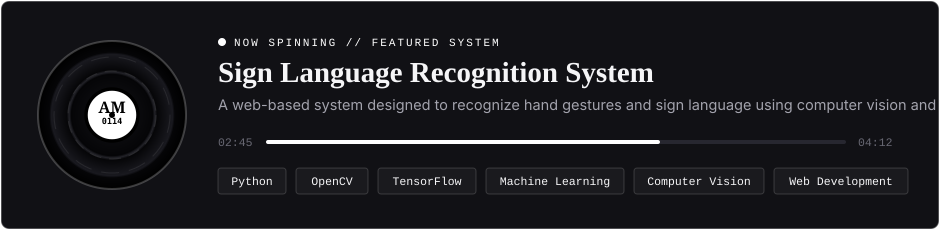

  

 

## `01 // SIDE A` — About Me *(“Do I Wanna Know?”)*

> I am a developer focused on **developing intelligent systems with AI**, integrating **machine learning** and **computer vision** into modern **web applications** and scalable software solutions.

| TRACK | FOCUS & ENGINEERING | LENGTH |
| :---: | :--- | :---: |
| **`A1`** | Developing **AI-powered systems and intelligent software solutions** | `04:32` |
| **`A2`** | Integrating **machine learning & computer vision** into real-world applications | `03:21` |
| **`A3`** | Engineering **full-stack web-based systems** and interactive platforms | `03:27` |
| **`B1`** | Designing **automated workflows and smart data-driven tools** | `04:13` |
| **`B2`** | Continuously refining **software architecture, engineering, and system design** | `05:05` |

  

## `02 // INSTRUMENTATION` — Technologies and Tools *(“R U Mine?”)*

<table width="100%">
  <tr>
    <td width="33%" valign="top">
      <code>CH. 01 // LEAD INSTRUMENTS</code>
      <h3>Programming Languages</h3>
      

        
      

      <code>Python • JavaScript • HTML • CSS • Next.js</code>
    </td>
    <td width="33%" valign="top">
      <code>CH. 02 // AMPLIFIERS &amp; FX</code>
      <h3>Frameworks &amp; Libraries</h3>
      

        
      

      <code>React • Node.js • TensorFlow • OpenCV</code>
    </td>
    <td width="34%" valign="top">
      <code>CH. 03 // STUDIO CONSOLE</code>
      <h3>Development Tools &amp; Cloud</h3>
      

        
        
        
      

      <code>Git • GitHub • Orca • Supabase • Firestore</code>
    </td>
  </tr>
</table>

  

## `03 // LEAD SINGLE` — Featured Project *(“Arabella”)*

  

  

## `04 // SIGNAL TRANSMISSION` — GitHub Activity & Current Focus *(“Back to 505”)*

<table width="100%">
  <tr>
    <td width="60%" valign="top">
      <code>OSCILLOSCOPE // CONTRIBUTION FREQUENCY — @TONYONTECH101</code>
        
      
    </td>
    <td width="40%" valign="top">
      <code>SETLIST // CURRENT FOCUS — LP SIDE B</code>
        
      <pre><code>01 AI-Driven Development       [█████]
02 Web Development             [█████]
03 Mobile Development          [█████]
04 AI Workflows                [█████]</code></pre>
    </td>
  </tr>
</table>

  
  
<em>“Four stars out of five.”</em> &nbsp;—&nbsp; <strong><a href="https://github.com/tonyontech101">@tonyontech101</a></strong>

